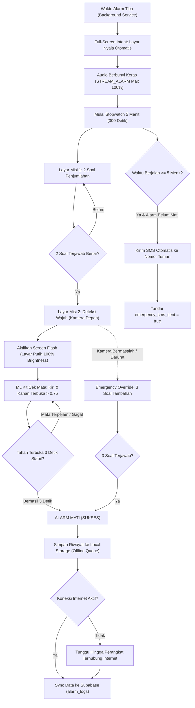

# Blueprint Arsitektur Teknis: Aplikasi Alarm Anti-Kesiangan Ekstrem

Aplikasi alarm berbasis Flutter untuk Android yang dirancang dengan sistem proteksi ketat, misi bertingkat (Matematika + Deteksi Wajah Mata Terbuka), fail-safe darurat SMS otomatis, dan pencatatan riwayat *offline-first* ke Supabase.

---

## 1. Spesifikasi Fitur & Keputusan Desain

| Komponen | Keputusan Desain | Keterangan Teknis |
| :--- | :--- | :--- |
| **Distribusi** | Sideloading APK Mandiri | Bebas menggunakan izin sensitif (`SEND_SMS`, DND bypass, Full-Screen Intent) tanpa review Google Play. |
| **Tampilan Layar Kunci** | Full-Screen Intent Langsung | Layar HP otomatis menyala (`turnScreenOn: true`) dan langsung menampilkan layar misi di atas lock screen (`showWhenLocked: true`). |
| **Audio & Volume** | Paksa Volume 100% & Tembus DND | Menggunakan audio stream `STREAM_ALARM`, menonaktifkan tombol volume, dan menembus mode *Do Not Disturb*. |
| **Anti-Restart Trap** | Boot Auto-Resume | Status alarm persisten disimpan di *local storage*. Jika HP dimatikan/restart saat alarm aktif, alarm langsung berbunyi kembali saat *booting* selesai. |
| **Misi 1: Matematika** | 2 Soal Penjumlahan Acak | Penjumlahan 2 digit (misal: `47 + 89`). Tombol *Back* perangkat dinonaktifkan (`PopScope`). |
| **Misi 2: Deteksi Wajah** | Google ML Kit (Mata Terbuka) | Memanfaatkan `leftEyeOpenProbability` dan `rightEyeOpenProbability` (> 0.75) selama 3 detik berturut-turut. |
| **Penerangan Kamar Gelap** | *Screen Flash* (Max Brightness) | Layar dipaksa kecerahan 100% dengan bingkai putih untuk menerangi wajah pengguna di subuh hari. |
| **Emergency Override** | 3 Soal Penjumlahan Tambahan | Mengatasi skenario jika kamera rusak, sensor kotor, atau situasi darurat fisik. |
| **Peringatan Sosial Darurat** | SMS Otomatis (> 5 Menit) | Jika alarm berbunyi $\ge 300$ detik tanpa selesai, Android `SmsManager` mengirim SMS darurat ke nomor teman yang didaftarkan. |
| **Database & Jaringan** | *Offline-First* Sync + Supabase | Seluruh alarm bekerja 100% offline. Log tersimpan di database lokal (`Hive`/`SQLite`/`SharedPreferences`) dan otomatis disinkronkan ke Supabase saat online. |
| **Identitas Pengguna** | Device UUID (Tanpa Login) | UUID acak dibuat saat pertama kali aplikasi diinstal. |

---

## 2. Alur Pengguna (User & Alarm Lifecycle)



---

## 3. Konfigurasi Android Native & Manifest

Untuk mengaktifkan seluruh fitur ekstrem di Android, berkas `android/app/src/main/AndroidManifest.xml` memerlukan konfigurasi izin dan service berikut:

```xml
<manifest xmlns:android="http://schemas.android.com/apk/res/android">

    <!-- Izin Alarm Presisi & Layar Penuh -->
    <uses-permission android:name="android.permission.SCHEDULE_EXACT_ALARM" />
    <uses-permission android:name="android.permission.USE_EXACT_ALARM" />
    <uses-permission android:name="android.permission.USE_FULL_SCREEN_INTENT" />
    <uses-permission android:name="android.permission.WAKE_LOCK" />
    <uses-permission android:name="android.permission.FOREGROUND_SERVICE" />
    <uses-permission android:name="android.permission.FOREGROUND_SERVICE_MEDIA_PLAYBACK" />

    <!-- Izin Tembus DND & Nyalakan Layar Saat Booting -->
    <uses-permission android:name="android.permission.ACCESS_NOTIFICATION_POLICY" />
    <uses-permission android:name="android.permission.RECEIVE_BOOT_COMPLETED" />

    <!-- Izin Kamera & SMS Darurat -->
    <uses-permission android:name="android.permission.CAMERA" />
    <uses-permission android:name="android.permission.SEND_SMS" />

    <application
        android:label="Alarm Ekstrem"
        android:showWhenLocked="true"
        android:turnScreenOn="true">
        
        <!-- Broadcast Receiver untuk Boot Auto-Resume -->
        <receiver
            android:name=".BootReceiver"
            android:enabled="true"
            android:exported="true">
            <intent-filter>
                <action android:name="android.intent.action.BOOT_COMPLETED" />
                <action android:name="android.intent.action.QUICKBOOT_POWERON" />
            </intent-filter>
        </receiver>
        
    </application>
</manifest>
```

---

## 4. Skema Database Supabase

Jalankan perintah SQL berikut di **Supabase SQL Editor**:

```sql
-- 1. Buat Tabel alarm_logs
create table public.alarm_logs (
    id uuid default gen_random_uuid() primary key,
    device_id text not null,
    alarm_scheduled_time timestamptz not null,
    alarm_triggered_at timestamptz not null,
    dismissed_at timestamptz,
    status text not null check (status in ('success', 'emergency_triggered', 'override_used', 'reboot_cheated')),
    math_solved_count int default 0,
    face_scan_duration_seconds int default 0,
    total_ringing_seconds int not null,
    emergency_sms_sent boolean default false,
    created_at timestamptz default now()
);

-- 2. Index untuk Query Analitik Berdasarkan Device ID & Waktu
create index idx_alarm_logs_device_id on public.alarm_logs(device_id);
create index idx_alarm_logs_created_at on public.alarm_logs(created_at desc);

-- 3. Row Level Security (RLS) - Buka akses Insert & Select berdasarkan Device ID
alter table public.alarm_logs enable row level security;

create policy "Allow insert for all anonymous clients"
on public.alarm_logs
for insert
with check (true);

create policy "Allow select based on device_id"
on public.alarm_logs
for select
using (true);
```

---

## 5. Rekomendasi Pustaka Flutter (Dependencies)

Tambahkan dependensi berikut ke dalam `pubspec.yaml`:

```yaml
dependencies:
  flutter:
    sdk: flutter

  # Alarm & Background Lifecycle
  alarm: ^5.0.0 # Mendukung Full-Screen Intent, Lock Screen, Audio Loop, dan Auto-Resume
  audioplayers: ^6.1.0

  # Kamera & ML Kit Deteksi Wajah
  camera: ^0.11.0+2
  google_mlkit_face_detection: ^0.13.0
  screen_brightness: ^2.0.0 # Untuk screen flash 100% kecerahan

  # SMS & Device
  telephony: ^0.2.0 # Untuk eksekusi background SMS otomatis
  uuid: ^4.5.1
  shared_preferences: ^2.3.3 # Cache status alarm & offline queue

  # Database Supabase & Jaringan
  supabase_flutter: ^2.8.0
  connectivity_plus: ^6.1.0 # Pengecekan koneksi untuk background sync
```

---

## 6. Rencana Tahapan Eksekusi (Implementation Roadmap)

1. **Tahap 1: Setup Proyek & Konfigurasi Supabase**
   * Inisialisasi proyek Flutter di direktori kerja `e:\aplikasi`.
   * Hubungkan `supabase_flutter` dengan `SUPABASE_URL` dan `SUPABASE_ANON_KEY`.
   * Buat helper lokal `DeviceIdentity` untuk membuat & menyimpan UUID permanen.

2. **Tahap 2: Engine Alarm & Layar Kunci (Android)**
   * Implementasikan package `alarm` dengan konfigurasi `showWhenLocked: true`.
   * Atur audio agar menggunakan channel `alarm` dengan volume 100%.
   * Buat layout `AlarmRingScreen` yang menonaktifkan tombol kembali (`PopScope`).

3. **Tahap 3: Misi 1 (2 Soal Penjumlahan)**
   * Generator soal matematika penjumlahan 2 digit (misal: $A \in [10..99], B \in [10..99]$).
   * Keypad custom di layar untuk respons cepat tanpa membuka keyboard sistem.

4. **Tahap 4: Misi 2 (Kamera & ML Kit Eye-Detection) + Screen Flash**
   * Inisialisasi kamera depan.
   * Set `screen_brightness` ke 1.0 (maksimum) dengan background frame putih.
   * Sambungkan stream *image buffer* kamera ke `FaceDetector` ML Kit.
   * Cek `leftEyeOpenProbability` dan `rightEyeOpenProbability` $\ge 0.75$ selama 3 detik stabil (animasi progress bar pengisi waktu).
   * Tombol *Emergency Override* (3 soal matematika tambahan jika kamera gagal).

5. **Tahap 5: Stopwatch & Fail-Safe SMS Darurat**
   * Timer 5 menit berjalan saat alarm mulai.
   * Jika $t = 300\text{s}$ dan alarm belum selesai: picu SMS via `telephony` ke nomor kontak darurat.

6. **Tahap 6: Offline Storage & Sinkronisasi Supabase**
   * Simpan riwayat keberhasilan/kegagalan ke `SharedPreferences` saat alarm dimatikan.
   * Background runner otomatis mem-push antrean lokal ke tabel `alarm_logs` Supabase begitu internet aktif.
